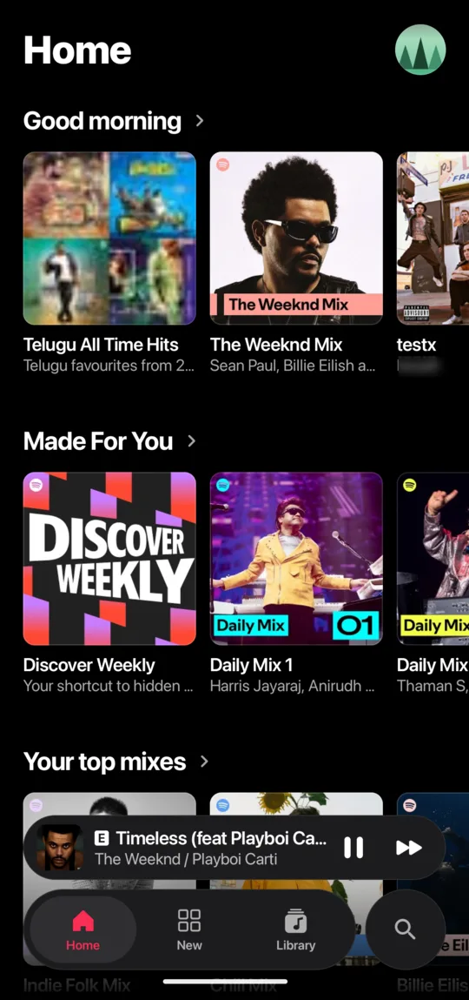
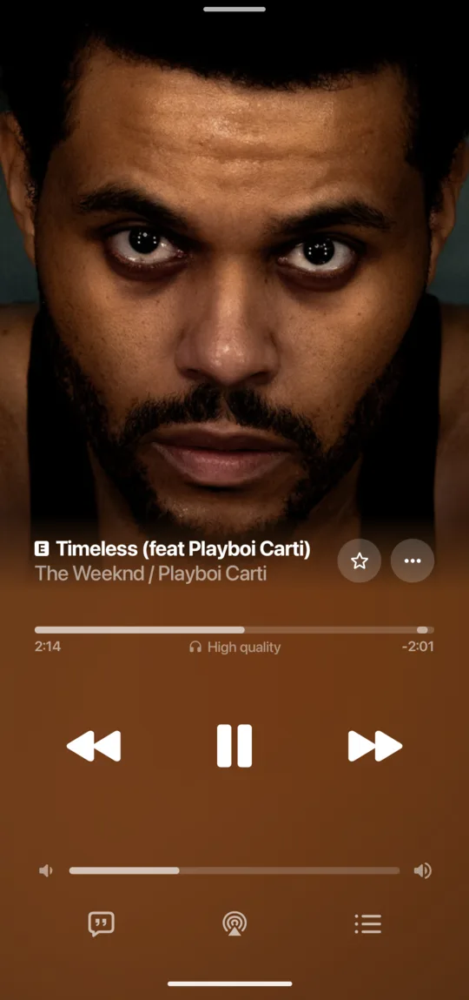
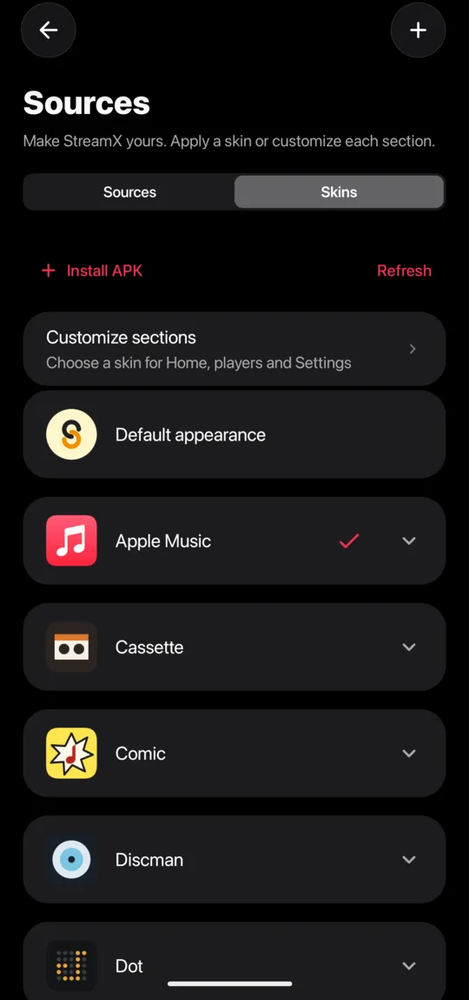
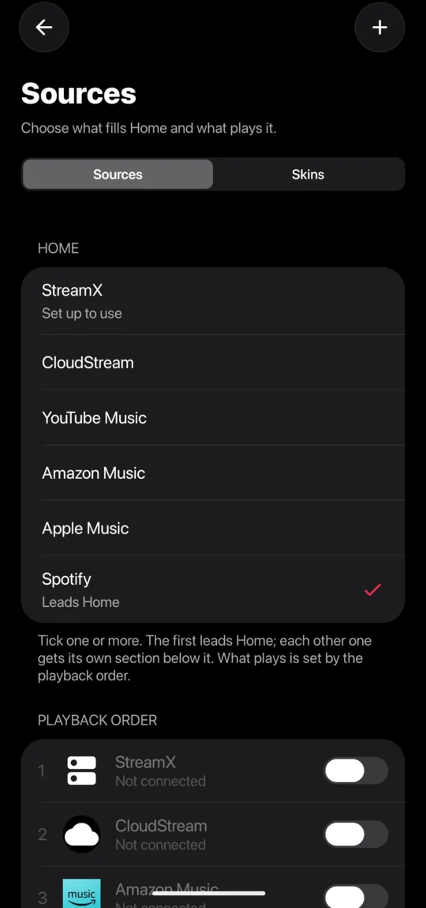
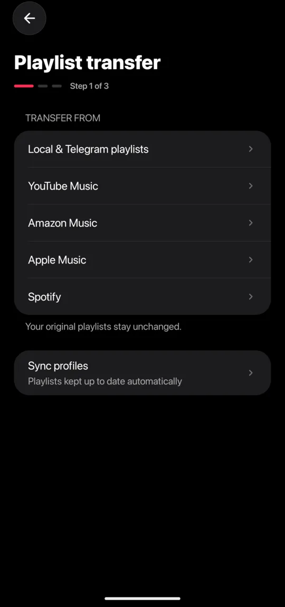
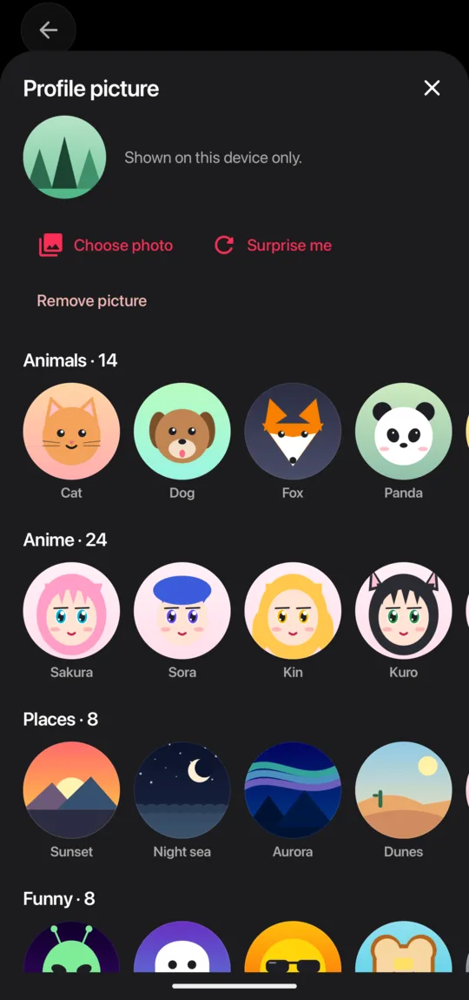

<div align="center">


# StreamX

<p align="center">
A music player for Android with your choice of sources, playlist transfer,<br>
and skins that change how you browse and play music.
</p>

[Download](https://github.com/StreamXProject/StreamX/releases/latest) ·
[Website](https://streamxproject.github.io/StreamX/) ·
[Skins](https://github.com/StreamXProject/Skins)

</div>

## Features

- **Your sources, your order** — Play from YouTube Music, JioSaavn, StreamX and CloudStream servers, addons, and plugins for Spotify, Apple Music and Amazon Music. Choose the order StreamX tries playback sources.
- **Playlist transfer** — Copy playlists between supported services, transfer several at once, or combine them into one destination playlist. Review uncertain track matches and save sync profiles to keep up with new additions. Available sources and destinations depend on provider and plugin support.
- **Skins beyond colors** — Change layouts and player interfaces with installable skins. Mix different skins for the home screen, full player and lyrics, mini player, and settings.
- **Playback essentials** — Automix, crossfade, equaliser, synced lyrics, timing adjustments and lyrics translation. Lossless playback, Dolby Atmos and USB DAC output are available where supported by the source, audio format and hardware.
- **Offline listening** — Download music for playback without a connection.
- **Listen Together** — Share a listening session with friends.
- **Google Cast** — Send playback to compatible devices.
- **Listening history and sharing** — Connect Last.fm, ListenBrainz and Discord.

## Screenshots

<table align="center">
  <tr>
    <td align="center"><br><sub>Home with the Apple Music skin</sub></td>
    <td align="center"><br><sub>Now playing</sub></td>
    <td align="center"><br><sub>Skins</sub></td>
  </tr>
  <tr>
    <td align="center"><br><sub>Sources, plugins and playback order</sub></td>
    <td align="center"><br><sub>Playlist transfer</sub></td>
    <td align="center"><br><sub>Profile pictures</sub></td>
  </tr>
</table>

## Install

Download `StreamX-arm64-v8a.apk` from the [latest release](https://github.com/StreamXProject/StreamX/releases/latest). Requires Android 8.0 or later.

## Build

Requires JDK 17, the Android SDK and the NDK.

```sh
cp local.properties.example local.properties
./gradlew :app:assembleProdDebug
```

Release signing reads `keystore.properties` (see `keystore.properties.example`).

## Credits

StreamX started as a fork of [BitChord](https://github.com/kushagrasinghx/BitChord) by [@kushagrasinghx](https://github.com/kushagrasinghx) and contributors.

## License

[GPL-3.0](LICENSE)
